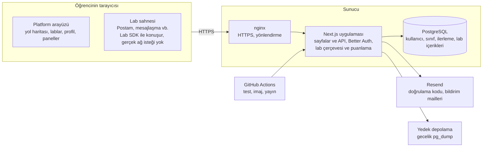

# Careful Mode Platform Dokümanı

8 Ekim 2026 · Murat Bulut

> Bu dosya asıl dokümanın kopyasıdır. Asıl hali Claude Docs'ta: [Careful Mode Platform Dokümanı](https://claude.ai/artifact/R5caxAQG8vWKdRFY1j3Lav). Değişiklik önce orada yapılır, sonra bu kopya güncellenir (son kopya: 15 Ekim 2026).

## 1. Amaç ve kapsam

Bu doküman, Careful Mode lablarının üzerinde çalışacağı **platformu** tanımlar: kullanıcılar, roller, lab çerçevesi, altyapı ve geliştirme fazları. Lab içerikleri (senaryolar) bu dokümanın konusu değildir. Burada yalnızca bir labın platforma nasıl takılacağı standardı yer alır.

Platformun temel fikri şudur: öğrenci önce kısa bir eğitim okur, ardından o konuya özel, gerçek bir uygulamaya benzeyen bir ekranda (ör. e-posta uygulaması, doğrulayıcı uygulaması) karar verir. Yanlış kararda simülasyon içinde "hacklenir", lab sonunda neyi kaçırdığını ve ne yapması gerektiğini görür. Sanal makine ya da sanal masaüstü yoktur; her şey öğrencinin tarayıcısında çalışır.

**Kapsamda (ilk sürüm)**

- E-posta + şifre ile kayıt/giriş, 6 haneli kodla e-posta doğrulama, şifre sıfırlama
- Öğrenci, öğretmen ve admin rolleri; öğretmenlik talebi ve admin onayı
- Kategori ve lab kataloğu, yol haritası (roadmap), ilerleme ve "tamamlandı" durumları
- Lab çerçevesi: eğitim bölümleri, lab uygulamasını çalıştırma, olay kaydı, "hacklendin" ekranı, sonuç raporu
- Öğretmen için sınıf kodu ve sınıf ilerleme tablosu
- Admin paneli: kullanıcılar, öğretmen talepleri, lab yayın durumu, temel istatistikler
- Çerçeveyi test etmek için tek bir örnek (demo) lab
- Docker ile sunucuda yayın, HTTPS, günlük yedek

**Kapsam dışında (ilk sürüm)**

- Asıl lab içerikleri (4 kategori × 3 lab; lab motoru bitince yönetim panelindeki formla yazılır)
- Liderlik tablosu (puan, seviye ve rozetler tasarımla ilk sürüme alındı)
- Google ile giriş, mobil uygulama, çoklu dil

## 2. Kullanıcı rolleri ve yetkiler

Platformda üç rol vardır: öğrenci, öğretmen ve admin. Her yeni hesap öğrenci olarak açılır. Öğretmenlik talep edilir ve admin onayıyla verilir. Yetki kontrolleri her zaman sunucu tarafında yapılır; menüde bir bağlantının gizlenmesi tek başına koruma sayılmaz.

| Durum / rol | Yapabilecekleri |
| --- | --- |
| Ziyaretçi (giriş yok) | Tanıtım sayfası, herkese açık yol haritası, kategori ve lab başlıklarını görme (eğitim içeriği ve lab sayfaları kapalı), kayıt olma |
| Öğrenci, e-posta doğrulanmamış | Eğitim bölümlerini okuma, profilini düzenleme, doğrulama kodu isteme |
| Öğrenci, e-posta doğrulanmış | Lab başlatma ve tamamlama, kendi ilerlemesini ve sonuç raporlarını görme, sınıfa kodla katılma, öğretmenlik talep etme |
| Öğretmen | Öğrencinin her şeyi + sınıf oluşturma, sınıf kodu paylaşma ve yenileme, kendi sınıfındaki öğrencilerin ilerleme tablosunu görme, öğrenciyi sınıftan çıkarma |
| Admin | Her şey + kullanıcı ve rol yönetimi, öğretmen taleplerini onaylama/reddetme, lab yayın durumu, istatistikler |
| Yönetim ekibi üyesi | Yöneticinin verdiği izinlere göre yönetim sayfaları: Talepler, Lab düzenleme, Lab yayını, İpucu, Gündem, Kayıt defteri (Roller sadece yöneticide). Öğrenci ekibe sadece İpucu ve Gündem izniyle girebilir |
| Okul sorumlusu | Öğretmenin her şeyi + Okulum sayfası: kendi okulunun toplam durumu (öğrenci adı yok), okulundan gelen öğretmen taleplerini onaylama, öğretmenlere hatırlatma ve davet bağlantısı. Öğrenci okul sorumlusu olamaz |

**Öğretmenlik talebi akışı**

1. Doğrulanmış bir öğrenci, profilindeki "Öğretmenlik talep et" butonuna basar.
2. Formu doldurur: okul/kurum adı, şehir, branş, varsa kurumsal e-posta, isteğe bağlı olarak öğretmenlik belgesi (PDF/görsel) ve kısa bir not.
3. Talep admin panelindeki "Öğretmen talepleri" listesine düşer, kullanıcı profilinde "İnceleniyor" durumunu görür.
4. Admin talebi onaylar ya da gerekçe yazarak reddeder. Onayda kullanıcının rolü öğretmen olur ve kendisine e-posta gider.
5. Karar verildikten sonra yüklenen belge sunucudan silinir (karar verilmeyen talepte yüklendikten 60 gün sonra); yalnızca karar, tarih ve kararı veren admin kayıtlı kalır.
6. Reddedilen kullanıcı beklemeden, yöneticinin notuna göre bilgileri düzeltip yeniden talep gönderebilir (12 Ekim kararı).

Bir öğrenci aynı anda birden fazla sınıfa üye olabilir. Sınıfa katılmak öğrencinin geçmiş ilerlemesini değiştirmez; öğretmen yalnızca kendi sınıflarındaki öğrencilerin lab ilerlemesini görür; sınıfı dışındaki hiçbir öğrencinin verisine erişemez.

## 3. Kullanıcı akışları ve ekranlar

Giriş yapmış kullanıcı için masaüstünde **üstte menü** vardır: Ana sayfa, Yol haritası, Lablar, Gündem; öğretmende ek olarak Sınıflarım, okul sorumlusunda Okulum. Profil (avatar) ve tema düğmesi header'ın sağındadır. Telefonda alt menü kullanılır, ortasında "Kaldığın yerden devam et" düğmesi durur. Yönetim paneli ayrı bir düzendir: masaüstünde solda menü, telefonda soldan kayan menü. Ayrıntılar bu bölümün sonundaki "Kodlarken uyulacak tasarım kararları" kısmındadır.

**Ekranlar**

| Ekran | Adres (öneri) | Kim görür | İçerik |
| --- | --- | --- | --- |
| Tanıtım sayfası | `/` | Herkes | Platformun ne olduğu, kategoriler, kayıt/giriş butonları |
| Kayıt / Giriş / Şifremi unuttum | `/kayit`, `/giris`, `/sifre-sifirla` | Ziyaretçi | E-posta + şifre formları |
| E-posta doğrulama | `/dogrula` | Doğrulanmamış öğrenci | 6 haneli kod girişi, kodu yeniden gönder |
| Yol haritası | `/yol-haritasi` | Öğrenci+ | Kategoriler sırasıyla, her labın durumu (kilitli / başlanmadı / devam ediyor / tamamlandı), önerilen sonraki lab |
| Lablar | `/lablar`, `/lablar/[kategori]` | Öğrenci+ | Kategori kartları ve lab listesi, filtre |
| Lab sayfası | `/lab/[lab]` | Öğrenci+ | Eğitim bölümleri → lab uygulaması → sonuç (Bölüm 4) |
| Sonuç raporu | `/lab/[lab]/sonuc/[deneme]` | Sahibi, öğretmeni, admin | Puan, kaçırılan işaretler, doğru davranışlar |
| Profil | `/profil` | Öğrenci+ | Ad, e-posta, tamamlanan lablar, şifre değiştir, sınıfa katıl, öğretmenlik talep et, hesabı sil. Yalnızca kullanıcının kendisi görür |
| Sınıflarım | `/siniflarim` | Öğrenci+ | Üye olduğu sınıflar, sınıf koduyla katılma |
| Sınıf yönetimi | `/ogretmen/siniflar/[sinif]` | Öğretmen | Sınıf kodu, öğrenci listesi, öğrenci × lab ilerleme tablosu |
| Yönetim | `/yonetim/...` | Admin | Kullanıcılar, öğretmen talepleri, lablar, istatistikler (Bölüm 3 sonu) |

**Yeni öğrencinin ilk akışı**

1. Kayıt olur (ad, e-posta, şifre, okul seviyesi: ortaokul / lise, KVKK onayı). Hemen giriş yapmış olur.
2. Yol haritasına gelir; eğitimleri okuyabilir. Üstte "Labları başlatmak için e-postanı doğrula" uyarısı durur.
3. İlk labı başlatmak istediğinde doğrulama ekranına yönlendirilir; e-postasına gelen 6 haneli kodu girer.
4. Labı tamamlar, sonuç raporunu görür, yol haritasında lab "tamamlandı" olur ve sıradaki lab önerilir.

**Yol haritası kuralı:** Bir kategorideki lablar sırayla açılır (bir öncekini tamamlamadan sonrakine geçilemez). Kategoriler birbirinden bağımsızdır; öğrenci istediği kategoriden başlayabilir. Yol haritası yalnızca önerilen sırayı gösterir.

**Sınıf ilerleme tablosu (öğretmen):** Satırlar öğrenciler, sütunlar lablar. Her hücrede durum ikonu ve en iyi puan bulunur. Üstte lab bazında tamamlama oranı ve "en çok hata yapılan lab" bilgisi yer alır. Tablo CSV olarak indirilebilir.

**Admin paneli:**

- **Kullanıcılar:** Arama, rol değiştirme, hesabı askıya alma/silme
- **Öğretmen talepleri:** Bekleyen talepler, onay/ret, gerekçe
- **Lablar:** Kod tarafında kayıtlı labların listesi, yayında/taslak durumu, sıralama
- **İstatistikler:** Kayıtlı kullanıcı, aktif kullanıcı, lab bazında başlatma/tamamlama/"hacklenme" oranları
- **Kayıtlar:** Admin işlemlerinin denetim kaydı (kim, neyi, ne zaman)

**Gizlilik kuralı (18 yaş altı kullanıcılar nedeniyle):** Herkese açık profil sayfası yoktur; her kullanıcı yalnızca kendi profilini görür. Kullanıcı arama, "son tamamlayanlar" listesi ve isimli aktivite akışı bulunmaz. Lab sayfalarında yalnızca isimsiz bir sayı gösterilir: "Bu labı 124 kişi tamamladı".

**Tasarım:** Hedef kitle ortaokul ve lise öğrencileri olduğu için arayüz çocukça değil ama ilgi çekici olmalıdır: koyu tonlu "siber" bir zemin, canlı vurgu renkleri, büyük ve okunaklı yazılar, az metin, bol ikon ve görsel. Renkler, yazı tipleri, bileşenler ve ekranlar ayrı tasarım dosyalarında (tuvallerde) görsel olarak tutulur; kodlama bu tasarıma göre yapılır. Tasarım 11 Ekim 2026'da bitti ve onaylandı: seçilen tema, bütün ekranlar ve kodlamaya taşınacak kararlar hemen aşağıdaki tasarım bölümlerindedir.

### Tasarım dili ve tema

Tasarım 11 Ekim 2026'da bitti: bütün ekranlar çizildi ve Murat tarafından onaylandı (tek bekleyen konu 13 yaş altı için veli onayı, aşağıda). Kodlama bu bölümdeki kararlara ve tuvallerdeki son hallere göre yapılır. Bu bölüm yukarıdaki "Ekranlar" tablosu ya da "Admin paneli" listesiyle çelişirse bu bölüm geçerlidir.

**Seçilen tema:** [Careful Mode Tema H](https://claude.ai/artifact/FgxEtBMShrGeZKwMTkWRoN), tuvaldeki "Seçilen tasarım v2" sırası. Masaüstünde H13A3, telefonda 1.3D. İki görünüm var: koyu (varsayılan) ve gri. Kullanıcı header'ın sağındaki tek düğmeyle değiştirir. Ekranlar koyu temada çizildi; renkler kodda tek yerden yönetildiği için gri tema aynı değişkenlerden kendiliğinden çıkar (hesap ekranları ve "Hacklendin" ekranı iki temada da çizildi).

| Görev | Koyu tema | Gri tema |
| --- | --- | --- |
| Sayfa zemini | #0B1020 | #DDE1E8 |
| Yüzey | #131A33 | #ECEEF2 |
| Kart, kutu | #1C2547 | #D2D7E1 |
| Kenarlık | #2A3459 | #C2C9D6 |
| Ana yazı | #E8ECF8 | #0F172A |
| İkincil yazı | #A3ADC8 | #5B6683 |
| Vurgu (cam göbeği) | #22D3EE | #22D3EE, yazıda #0E7490 |
| Başarı / güvende | #34D399 | #059669 |
| Uyarı | #FBBF24 | #B45309 |
| Tehlike | #F87171 | #B91C1C |

**Yazı tipleri:** başlıklarda Space Grotesk, metinde DM Sans, kod, sayı ve kısa etiketlerde JetBrains Mono.

**Genel ilkeler:**

- Her ekran masaüstü ve telefon (390 px) için ayrı çizildi; telefon hali masaüstünün küçültülmüşü değil, kendi düzeni var.
- Çocukça değil ama canlı: kısa metin, büyük başlık, ikon, küçük animasyonlar.
- Her ekran bir şey öğretir: kayıtta canlı şifre gücü, girişte dönen ipuçları, doğrulamada "Bu kodu kimse senden isteyemez", çerez bandında "Neden önemli?".
- Labdaki uygulamalar kendi görünümünü korur, site temasıyla değişmez. Örnek: mail uygulaması Postam turuncu (#EA580C) logo ve beyaz zemindir.
- Telefonda "hareketi azalt" açıksa sarsıntı ve flaş olmaz, sadece renk değişir.

### Tasarım süreci

Tasarım önce temayla, sonra beş turda ekran ekran yapıldı. Her turda her ekran için 3-4 varyant çizildi (masaüstü ve telefon yan yana), Murat birini seçti, seçilen revize edilip "son hali" olarak tuvale kondu. Tuvallerde son haller adı "-Son" ile biten tahtalardadır. Tuvallerin hepsi yerinde duruyor; eski turlar sonradan değiştirilmedi, bir ekran sonraki turda güncellendiyse geçerli olan sonraki turdur.

| Aşama | Tarih | Kapsam | Tuval |
| --- | --- | --- | --- |
| İlk taslak | 8 Ekim | Koyu zemin ve cam göbeği vurgulu ilk tasarım | [Careful Mode Tasarım](https://claude.ai/artifact/189LroTQyL2YyFiK1UxaPV) |
| Tema denemeleri | 8 Ekim | B, C ve D temaları | [Tema Denemeleri](https://claude.ai/artifact/BxUb9oN3yxnvP7tePjTbsQ) |
| Tema denemeleri 2 | 8-9 Ekim | E, F ve G temaları | [Tema Denemeleri 2](https://claude.ai/artifact/SExi87UnPVMPWNCmvduPf9) |
| Tema H (seçilen) | 9 Ekim | Tanıtım sayfası (masaüstü + mobil, koyu + gri), öğrenci ana sayfasının ilk mobil hali, tema düğmesi, günün ipucu şeridi | [Careful Mode Tema H](https://claude.ai/artifact/FgxEtBMShrGeZKwMTkWRoN) |
| Tur 1 | 9 Ekim | Hesap ekranları (kayıt, giriş, e-posta doğrulama, şifremi unuttum) ve lab akışı (lab detayı, eğitim oynatıcısı, lab çerçevesi, Hacklendin, sonuç raporu) | [Tur 1](https://claude.ai/artifact/M5CPjhpqjLwWyLFcgbrE6R) |
| Tur 2 | 10 Ekim | Öğrenci: ana sayfa (masaüstü + mobil), yol haritası (siber şehir), lablar kataloğu, profil, gündem; bunların ziyaretçi halleri | [Tur 2](https://claude.ai/artifact/37CyJtkysjEVCX7WM1CzVc) |
| Tur 3 | 10 Ekim | Öğretmen: öğretmenlik talebi, sınıflarım, sınıf detayı (ödev ver), öğretmenler için tanıtım sayfası | [Tur 3](https://claude.ai/artifact/9wsRpX3LRq3SUc3j9z5i7E) |
| Tur 4 | 10-11 Ekim | Yönetim: öğretmen talepleri, kullanıcılar ve okullar, Okulum, kayıt defteri, lab yönetimi ve lab düzenleme, günün ipucu, gündem yönetimi; herkese açık SSS | [Tur 4](https://claude.ai/artifact/TxyQFgGbsAHxdjzqwsHEkL) |
| Tur 5 | 11 Ekim | Kalanlar: özet paneli ve Canlı nabız, çerez bandı, 404 ve durum ekranları, yasal sayfalar, mobil ziyaretçi menüsü; açık kararlar (seviye tablosu, Hacklendin, rapor). Tuval "Son haller" sayfasından açılır | [Tur 5](https://claude.ai/artifact/HrcHYiRY4kD5iwRJTjLMPA) |

Yedekler ve çizim kaynakları proje dosyalarında, `tasarim/` klasöründe: güncel ekran listesi `ekran-listesi.md`, her turun ayrıntılı karar notları `tur1-plan.md` ... `tur5-plan.md`, tahtalar ve kaynaklar `tur1/` ... `tur5/`.

### Onaylanan ekranlar

Numaralar `tasarim/ekran-listesi.md` ile aynıdır. "Tur" sütunu son halin hangi tuvalde olduğunu söyler.

**Ziyaretçi (giriş yapmadan)**

| No | Ekran | Seçilen tasarım | Tur |
| --- | --- | --- | --- |
| - | Tanıtım sayfası | Akan iplikler, Postam animasyonu, kaydırmalı adım kartları, gündem manşeti | Tema H, Tur 2 |
| 1-2 | Yol haritası ve kategori (herkese açık) | Öğrencinin yol haritasının ilerlemesiz hali; senaryo labları kilitli, "Kayıt ol ve başla" kayıt penceresini açar. Ayrı kategori sayfası yok, mahalle içi o işi görür | Tur 2 |
| 3 | Öğretmenler için | T4 "İki ekran, bir ders": öğretmen ekranı ve öğrenci telefonu eş zamanlı | Tur 3 |
| 4 | KVKK, gizlilik, kullanım koşulları | Y2: her bölümde öğrencinin anlayacağı "Kısaca" + tam metin | Tur 5 |
| 4b | Gündem listesi ve haber detayı | G2 zaman çizelgesi; detayda H2 yan sütun ("Kısaca", lab kutusu, kaynak, "Careful Mode'dan ayrılıyorsun" penceresi) | Tur 2 |
| 4c | Sık sorulan sorular | F3 "Önce söyle: sen kimsin?" (öğrenci, öğretmen, aile, sadece bakıyorum); 19 soru | Tur 4 |
| 4d | Mobil ziyaretçi menüsü | M2 alt menü | Tur 5 |

**Hesap**

| No | Ekran | Seçilen tasarım | Tur |
| --- | --- | --- | --- |
| 5 | Kayıt ol | Ortada tek kart, canlı şifre gücü göstergesi, eğitim durumunda varsayılan yok. Veli onayı bekliyor | Tur 1 |
| 6 | Giriş yap | 3 dönen animasyonlu ipucu, 5 hatalı denemede bekleme; ilk gelişte "Hoş geldin", sonra "Tekrar hoş geldin" | Tur 1 |
| 7 | E-posta doğrulama | 6 haneli kod, giden mail, doğrulanmamış hesap şeridi | Tur 1 |
| 8 | Şifremi unuttum | Önce 4 adımlık rehber, sonra kodla sıfırlama (bağlantı yok) | Tur 1 |

**Öğrenci**

| No | Ekran | Seçilen tasarım | Tur |
| --- | --- | --- | --- |
| - | Ana sayfa | A1 profil kartı (seviye, puan, 5 rozetlik vitrin), günün ipucu, sınıfa katıl ve ödev, sıradaki rozet, gündem ve istatistikler, siber şehir, son raporlar. Telefonda M2 kaydırmalı kartlar | Tur 2, Tur 3 |
| 9 | Yol haritası | Siber şehir: önce mahalle kartları (H4), mahalleye girince rota çizgili liste ve önizleme (İ4-A) | Tur 2 |
| 10 | Lablar | L1 kart ızgarası ve F1 açılır filtreler (kategori, tür, zorluk, durum), arama, sıralama | Tur 2 |
| 11 | Lab detayı | Lab kapağı: eğitim → senaryo → rapor adımları | Tur 1 |
| 12 | Eğitim labı oynatıcısı | Sabit header ve ince oynatıcı şeridi; bitince senaryo labları açılır | Tur 1 |
| 13 | Lab çerçevesi | Görevler sırayla açılır; her mailde Bildir / Yanıtla / Sil; yanlış bildirim hata sayılır | Tur 1 |
| 14 | Hacklendin | Önce sahte sayfa, sonra yumuşak bordo + pembe alarm (avatar griye döner, Postam bildirimleri); açıklama B zaman tüneli | Tur 1, Tur 5 |
| 15 | Sonuç raporu | Labdaki gerçek kararlara göre değişir; masaüstünde "Adım adım" C seç ve gör; sadece koyu | Tur 1, Tur 5 |
| 16 | Profil | P2 ayarlar menüsü: Hesap bilgileri, Rozetler, Avatar, Görünüm, Güvenlik, Sınıf, Öğretmenlik, Hesabı sil | Tur 2, Tur 5 |

**Öğretmen**

| No | Ekran | Seçilen tasarım | Tur |
| --- | --- | --- | --- |
| 17 | Öğretmenlik talebi | Ayrı ekran yok, profildeki Öğretmenlik bölümü. İl ve ilçe seçilir, okulun adı yazılır (okul listesi gösterilmez); haller: inceleniyor, bilgi istendi, onaylandı, onaylanmadı | Tur 3, Tur 4 |
| 18 | Sınıflarım | C1 kartlar ve C3 özet kutuları, "Dikkat isteyenler" | Tur 3 |
| 19 | Sınıf detayı | D2 sekmeli (Genel bakış / Öğrenciler / Konular), öğrenci çekmecesi, "Ödev ver" | Tur 3 |

**Yönetim**

| No | Ekran | Seçilen tasarım | Tur |
| --- | --- | --- | --- |
| 20 | Özet paneli ve Canlı nabız | P1 önce yapılacaklar (işler bitince kartlar kalkar); ayrı "Canlı nabız" sekmesi: şu an labdaki kişi sayısı, mahalle dağılımı, isimsiz akış | Tur 5 |
| 21 | Öğretmen talepleri | A4 kontrol listesi (en az 2 kontrol olmadan onay yok), "Bilgi iste", "Yeni okul" etiketi, 5 sn geri al | Tur 4 |
| 22 | Kullanıcılar ve okullar | Genel (öğrenciler, öğretmenler, yönetim ekibi ve izinleri) ve Okullar (okul ekle, sorumlu ata); öğrencinin kısa profili | Tur 4 |
| 22b | Kayıt defteri | Kim neyi yaptı; arama ve filtre, kayıtlar silinmez | Tur 4 |
| 22c | Okulum (okul sorumlusu) | O4 haftalık okul bülteni; sadece kendi okulu, öğrenci adı yok | Tur 4 |
| 23 | Lab yönetimi | B1 mahalle grupları ve üstte Yayında / Taslak / Gizli sayıları, "Lab ekle" | Tur 4 |
| 23b | Lab düzenleme | L1: solda bölümler, ortada form, sağda önizleme ve "Öğrenci gibi dene"; kod yok | Tur 4 |
| 24 | Günün ipucu | C3 bugün, sıradaki 6 gün ve havuz | Tur 4 |
| 24b | Gündem yönetimi | E1 liste ve editör, "Önizle" ayrı ekranda, "Yayına hazır mı?" listesi | Tur 4 |

**Ortak parçalar**

| No | Ekran | Seçilen tasarım | Tur |
| --- | --- | --- | --- |
| 25 | 404 ve durum ekranları | 404 D1 sade; yükleniyor, boş durumlar, bağlantı koptu, lab açılamadı, sunucu hatası, oturum kapandı, bakım | Tur 5 |
| 26 | Çerez bandı | Ç4 dürüst bant, "Neden önemli?" mini dersi | Tur 5 |

### Kodlarken uyulacak tasarım kararları

**Menüler**

- Ziyaretçi, masaüstü: üstte Yol haritası, Lablar, Gündem, Öğretmenler için, SSS, sonra Giriş yap ve Ücretsiz kayıt ol. Telefonda M2 alt menü: Ana sayfa, Yol haritası, ortada Kayıt ol, Gündem, Daha fazla (Lablar, Öğretmenler için, SSS). Bu alt menü bütün ziyaretçi sayfalarının telefon halinde vardır.
- Öğrenci, masaüstü: üstte Ana sayfa, Yol haritası, Lablar, Gündem; sağda profil (avatar) ve tema düğmesi. Telefonda alt menü: Ana sayfa, Yol haritası, ortada "Kaldığın yerden devam et", Lablar, Profil.
- Öğretmen: masaüstü menüsüne Sınıflarım eklenir; telefonda alt menü Ana sayfa, Lablar, devam düğmesi, Sınıflar, Profil. Okul sorumlusunda ayrıca Okulum çıkar. Yönetici yalnızca öğretmenlik talebi onaylanmışsa (ya da sınıfı varsa) öğretmen sayılır; yoksa Sınıflarım görünmez (15 Ekim).
- Yönetim ekibindeki kişinin avatar menüsünde Profil ile Çıkış arasında "Yönetim paneli" bağlantısı vardır (15 Ekim).
- Sınıf kartı ve ödev bandı yüzde değil kişi sayısı yazar: "9/12 bitirdi" (15 Ekim).
- Mahalle ve yönetimdeki oda sayıları eğitim ve senaryo odalarını birlikte sayar ("eğitim + 3 senaryo odası", 15 Ekim).
- Yönetim ayrı bir düzendir: masaüstünde solda menü (üstte "YÖNETİM" etiketi, altta "Siteye dön"), telefonda soldan kayan menü. Sıra: Özet, Canlı nabız, Öğretmen talepleri, Kullanıcılar, Lablar, Günün ipucu, Gündem, Kayıt defteri. Kişi sadece izni olan sayfaları görür.

**Siber şehir ve lablar**

- Kategoriler bir şehrin mahalleleridir: Hesap Kalesi, Oltalama Limanı, Yazılım Ormanı, Para Çarşısı, Dostluk Parkı (güvenli iletişim: siber zorbalık, çevrim içi tanışma, yapay zekâ; 15 Ekim). Adlar ileride değişebilir. Yeni kategori yeni bir mahalle demektir; harita, mahalle ve lab sayısına göre kendini dizer.
- Bir mahallede birden çok eğitim labı olabilir (15 Ekim). İlki **temel eğitim**dir, her zaman açıktır; diğerleri **ileri eğitim**dir, temel eğitim bitince açılır. Her senaryo labını bir eğitim açar (boşsa temel eğitim): öğrenci o eğitimi bitirince senaryo açılır. Sırayı öğrenci seçer, isterse önce bütün eğitimleri bitirir. Haritada her eğitimin ardından onun açtığı senaryolar durur; bu sıra yönetimdeki sıranın aynısıdır.
- Tasarımdaki örnek içerik 4 eğitim + 16 senaryo labıdır; gerçek lab sayısı içerik yazılırken belli olur.
- Gündem haberlerini ekip yazar, haber sadece okunur. Kaynağa giderken "Careful Mode'dan ayrılıyorsun" penceresi çıkar.

**Puan, seviye ve rozetler** (Murat onayladı, 11 Ekim)

- Eğitim labını bitirmek 100 puan, senaryo labı rapor puanı (100 üzerinden) × 2 (100/100 = 200 puan). Aynı lab tekrar yapılırsa en iyi deneme sayılır.
- 10 seviye var, eşikler sabit. Öğrenciye toplam seviye sayısı hiçbir yerde gösterilmez ("x/10" yok). Yerine "Seviye 3 · Sonraki seviyeye 40 puan kaldı" yazar; 10. seviyede "Bütün seviyeleri tamamladın" çıkar.

| Seviye | Unvan | Gereken puan |
| --- | --- | --- |
| 1 | Acemi | 0 |
| 2 | Dikkatli gezgin | 150 |
| 3 | Bilinçli kullanıcı | 400 |
| 4 | İz sürücü | 700 |
| 5 | Dedektif | 1.000 |
| 6 | Kalkan ustası | 1.350 |
| 7 | Uzman | 1.700 |
| 8 | Koruyucu | 2.050 |
| 9 | Siber muhafız | 2.400 |
| 10 | Siber kahraman | 2.700 |

- 13 rozet: Şifre ustası, Oltalama avcısı, Virüs savar, Cüzdan bekçisi, Dost eli (her biri kendi mahallesinin temel yolunu, yani temel eğitimin açtığı senaryoları bitirince; ileri eğitimin senaryoları gerekmez), Şehir turu (senaryo labı olan her mahallede bir senaryo labı), İlk rapor, Kart kurdu, Kusursuz (bir labdan 100/100), Geri dönüş (hacklendiğin labı tekrar yapıp güvende kalmak), Sınıf arkadaşı, Meraklı (7 farklı gün "Neden?"e bakmak), Siber kahraman (en üst seviyeye ulaşmak).
- Ana sayfadaki vitrinde en fazla 5 rozet olur; öğrenci hangilerini göstereceğini profilden seçer.
- Her rozetin ikonu ayrı bir dosyadır (`rozetler/<rozet-adi>.svg`, PNG de olur), kazanılmamış rozette aynı ikon gri ve soluk görünür. Murat ikonları kendi tasarımıyla değiştirecek. Yeni rozet eklemek listeye bir satır ve bir ikon dosyası demektir.
- Liderlik tablosu yoktur.

**Ödev**

- Öğretmen sınıf detayından "Ödev ver" ile bir mahalle ve o mahalleden istediği odaları seçer (15 Ekim). Seçtiği senaryoyu ya da ileri eğitimi açan eğitim ödeve kendiliğinden girer, yoksa öğrenci odayı açamaz. Ödev puanlanmaz, öğretmen sadece kimin bitirdiğini görür; son tarih isteğe bağlıdır ve aynı anda tek ödev olur. Ödev öğrencinin ana sayfasındaki sınıf kutusunda görünür.

**Yönetim ekibi ve okullar**

- Yönetici her şeyi yapar. Yönetim ekibindeki kişilere 7 izinden istenenler verilir: Talepler, Lab düzenleme, Lab yayını, İpucu, Gündem, Kayıt defteri, Roller (Roller sadece yöneticide). Öğrenci ekibe sadece İpucu ve Gündem izniyle girebilir.
- Okullar il ve ilçeyle bir listede tutulur; bu listeyi yalnızca yönetim görür. Öğretmen talepte il ve ilçeyi seçip okulunun adını yazar. Ad listedeki bir okulla aynıysa talep o okula bağlanır; değilse "Yeni okul" etiketiyle gelir, yönetici benzer okulla eşler ya da adı düzeltip okulu ekler. Böylece kimse hangi okulların sistemde olduğunu göremez ve okul verisi dışarıdan çekilmez.
- Her okula bir okul sorumlusu atanabilir. Sorumlu öğretmen olabilir, öğrenci olamaz. Okulum sayfasında sadece kendi okulunu, öğrenci adı olmadan görür; okulundan gelen öğretmen taleplerini onaylar, "Tanımıyorum" derse karar yöneticiye kalır.
- Öğretmen talebinde üç karar vardır: Onayla, Reddet, Bilgi iste. Onay için en az 2 kontrol işaretlenmelidir; ret notu ve sorulan bilgi öğretmenin profiline gider.
- Her yönetim işleminden sonra 5 saniye "Geri al" vardır ve işlem kayıt defterine yazılır. Kayıtlar silinmez, düzenlenmez.
- Özet panelindeki iş kartları gerçek sayılardan gelir: iş bitince kart kendiliğinden kalkar, "Bugün değil" bir günlüğüne saklar, hepsi bitince tek satır kalır.

**Gizlilik ve güvenlik**

- Herkese açık yerlerde, özet panelinde, Okulum'da ve Canlı nabız akışında öğrenci adı yoktur, sadece toplam sayılar vardır (örneğin "124 öğrenci tamamladı").
- Yönetim, öğrencinin kısa profilini görebilir (Ad S., bitirdiği lablar, son aktif olduğu zaman, 4 haftalık takvim); e-posta, soyad ve puan görünmez, profile bakmak kayıt defterine yazılır.
- Öğrenciler arasında mesajlaşma yoktur.
- Hatalı girişte "E-posta ya da şifre hatalı" yazar, hangisinin yanlış olduğu söylenmez; 5 hatalı denemeden sonra geri sayım başlar.
- Şifre sıfırlama mailde bağlantıyla değil 6 haneli kodla yapılır. "Kod gönderildi" mesajı hesap olsa da olmasa da aynıdır.

**Çerez ve yasal metinler**

- Sadece gerekli çerezler (oturum ve tema) vardır; reklam, takip ve istatistik çerezi yoktur. Bu yüzden çerez bandı da yoktur (4 Kasım, Murat: "şu an çerezlik bir durum yok, gerekirse ekleriz"); çerezler gizlilik politikasında anlatılır. İsimsiz istatistik eklenirse açık rıza bandı geri gelir.
- Yasal metinler taslaktır. Köşeli parantezli yerler (\[VERİ SORUMLUSU\], \[KVKK BAŞVURU E-POSTASI\], \[BARINDIRMA HİZMETİ\], \[SÜRE\]) doldurulup hukuki kontrolden geçmeden yayına çıkmaz.

### Açık konular ve dokümanın geri kalanına etkisi

**Tasarımda açık kalanlar** (hiçbiri kodlamanın başlamasını durdurmaz):

- **Veli onayı (13 yaş altı):** Murat danışman hocayla konuşacak, tamamen kaldırılabilir. Karar gelene kadar kayıt akışı değişmez. Konuşulacak üç yol Tur 5 tuvalinde hazır: veli e-postası, sınıf koduyla okul üzerinden, 13 yaş altına kayıt yok.
- **"Lab" kelimesinin Türkçesi:** Karar verildi (13 Ekim 2026): **Oda** (Eğitim odası, Senaryo odası). Arayüz metinleri ve sayfa adresleri değişti (`/odalar`, `/oda/...`, `/yonetim/odalar`; eski adresler yenisine yönlenir). Kodda ve bu dokümanda kavramın adı "lab" kalır.
- **Mahalle ve şehir adları** ileride değişecek.
- **Rozet ikonları:** Murat kendi tasarımıyla hazırlayıp dosyaları değiştirecek. Avatarlar şimdilik emoji, gerçek set ileride çizilecek.
- **Kart kataloğu, karşılaştırma kartı (marka ve telif sorusu) ve labdaki "lab kimliği":** lab içerikleri yazılırken konuşulacak.

**Dokümanın geri kalanına etkisi:** Tasarım, dokümanın ilk halinde olmayan bazı şeyleri ilk sürüme aldı: puan, seviye ve rozetler, ödev, yönetim ekibi ve izinler, okullar ve okul sorumlusu, gündem, günün ipucu, SSS, Canlı nabız ve labların formla yazılması. Doküman 11 Ekim'de buna göre güncellendi:

- Kullanıcı rolleri tablosu (Bölüm 2) ve menü paragrafı (Bölüm 3).
- Lab yapısı: lablar kod klasörü yerine şablon üzerine formla yazılan içerik (Bölüm 4 ve 5).
- Veri modeli (Bölüm 6).
- Faz planı ve tarihleri (Bölüm 9), açık kararlar, "Kapsam dışı" ve "İleride eklenebilecekler" listeleri.

Yukarıdaki eski "Ekranlar" tablosu ve "Admin paneli" listesi ilk plan olarak duruyor; ekranların geçerli hali bu bölümdeki tablolardır.

## 4. Lab çerçevesi ve lab ekleme standardı

Her lab, platformun ortak **lab çerçevesi** içinde çalışır. Çerçeve her labda aynı olan işleri yapar: eğitim kartlarını göstermek, sahneyi başlatmak, olayları sunucuya kaydetmek, "hacklendin" ekranını ve sonuç raporunu göstermek. Lablar kod olarak değil **içerik olarak** tutulur: her lab bir **şablon** (sahne türü: gelen kutusu, mesajlaşma, ileride sahte giriş sayfası, indirme sayfası, sosyal medya) üzerine, yönetim panelindeki Lab düzenleme formuyla yazılır ve veritabanında durur. Yeni lab eklemek kod yazmayı gerektirmez; yeni bir sahne türü eklemek ise bir kez kod yazmayı gerektirir. Bu, tasarımda onaylanan "kod yok, her şey form" kararının sonucudur (Tur 4).

**Bir labın aşamaları**

1. **Eğitim:** Kart kart ilerleyen kısa bir ders (yönetim panelindeki formdan yazılır). Her kartta bir görsel veya animasyon ve 1-2 cümle bulunur; aralara küçük etkileşimler girer ("şüpheli yeri bul ve tıkla", tek soruluk mini test). İsteğe bağlı olarak 2-3 dakikalık bir video ve videoya ait birkaç soru eklenebilir. Bu bileşenler (kart `Card`, tıkla-bul `ClickFind`, mini test `MiniQuiz`, video `Video`) platformda bir kez yazılır, her labda kullanılır. Kartlar sırayla açılır; ilerleme kaydedilir.
2. **Lab:** Lab uygulaması tam ekran açılır. Üstte ince bir çerçeve çubuğu (lab adı, görev metni, "labı bitir" ve "çık" butonları) durur. Görevler/sorular gerekiyorsa açılıp kapanan bir yan panelde gösterilir.
3. **Hacklendin ekranı (olursa):** Öğrenci tehlikeli bir eylem yaptığında lab, çerçeveye bir "ele geçirilme" olayı bildirir. Çerçeve türüne göre etkileyici bir sahne gösterir: hesap ele geçirildi, dosyalar şifrelendi (fidye mesajı), kişisel veriler sızdı, banka hesabın suçta kullanıldı. Ardından sonuç raporuna geçilir.
4. **Sonuç raporu:** 100 üzerinden puan (formdaki ham puanların toplamı 10, raporda × 10), doğru yapılanlar, kaçırılan işaretler ("Gönderen adresi `destek@g00gle-guvenlik.com` idi"), ne yapılmalıydı ve "tekrar dene" butonu. Lab sınırsız kez tekrar edilebilir; toplam puana labın en iyi denemesi sayılır (rapor puanı × 2; eğitim labı 100 puan).

**Şablon ve içerik yapısı**

```
lib/lab/                   # lab motoru (sunucu)
  content.ts               # içerik şeması (Zod): kapak, eğitim kartları, sahne, görevler, rapor
  client.ts                # tarayıcıya giden içerik (doğru kararlar ve puanlar çıkarılır)
  actions.ts               # sunucu eylemleri: başla, olayları gönder, bağlantı, bitir
  events.ts  story.ts      # olaylar; bağlantının açtığı sayfa ve hacklendin hikâyesi
  scoring.ts  report.ts    # puan (100 üzerinden) ve rapor metinleri
  checklist.ts             # "Yayına hazır mı?" denetimi
components/lab/            # oynatıcı (tarayıcı)
  driver.ts                # LabDriver: oynatıcının sunucuyla konuştuğu tek arayüz
  frame/                   # çerçeve: üst çubuk, görev paneli
  training/                # eğitim: kart, tıkla-bul, mini test, video
  inbox/                   # gelen kutusu (Postam)
  messaging/               # mesajlaşma
  hacked/  report/         # hacklendin ekranı, sonuç raporu
  preview/                 # yönetimdeki önizleme (tarayıcıda çalışan sürücü)
components/admin/editor/   # Lab düzenleme formu
labs/examples/             # örnek lablar (JSON), başlangıç verisiyle veritabanına yüklenir
```

**Lab içeriği** (veritabanında, `LabVersion.content`): kapak (başlık, hikâye, mahalle, zorluk, süre), sahne (şablona göre: mailler, sohbet mesajları, eğitim kartları ve video), tuzaklar ve doğru kararlar, görevler, rapor metinleri ve ipuçları. Kapak, görevler, rapor ve ipuçları her labda aynıdır; sahne ve tuzak bölümü şablona göre değişir. Her şablon formun hangi alanlarla açılacağını kendi şemasıyla söyler. Lab taslakta düzenlenir, "Yayınla" denince yeni bir versiyon olur.

**Lab ile çerçeve arasındaki sözleşme (Lab SDK)**

Oynatıcı sunucuyla yalnızca `LabDriver` arayüzünden konuşur (`components/lab/driver.ts`). Öğrencide sunucu eylemleri (`lib/lab/actions.ts`), yönetimdeki önizlemede tarayıcıda çalışan bir sürücü kullanılır. Oynatıcı doğru cevabı hiç bilmez; bağlantının ne açacağını, hacklenip hacklenmediğini ve raporu hep sürücü söyler:

| Fonksiyon | Ne için |
| --- | --- |
| `start()` | "Hazırım, başla": denemeyi açar ya da yarım kalan denemeyi verir |
| `send(batch)` | Öğrencinin eylemlerini toplu gönderir: `item_opened` (mail ya da mesaj açıldı), `item_moved` (bildirdi, sildi, klasöre taşıdı), `attachment_opened`, `review_done` (İncelemeyi bitirdim), `answer` (soru) |
| `openLink(item)` | Bağlantıya tıklandı (`link_clicked`): sahte maildeyse sahte sayfa, gerçekteyse yalnızca adres gösterilir |
| `submitTrap(item)` | Sahte sayfada bilgi girildi (`info_entered`, yazılan metin gelmez); hacklendin hikâyesi döner |
| `sendReply(item, withSecret)` | Mesajlaşmada cevap yazıldı (`reply_sent`); sahte konuşmaya kodu verdiyse hacklendin hikâyesi döner |
| `finish()` | Labı bitirir; sunucu puanı ve raporu hesaplar, rapor sayfası açılır |

Eğitim labının sürücüsü ayrıdır: `spot` (tıkla-bul), `answer` (mini test) ve `save` (kaldığı kart). Hacklendin türü (`account` hesap, `ransom` fidye, `data_leak` veri sızıntısı, `financial` finansal) labın içeriğinde seçilir.

**Kurallar:**

- Puan ve geri bildirim her zaman **sunucuda** hesaplanır. Doğru cevaplar ve kurallar tarayıcıya gönderilmez; böylece sayfa kodundan cevap okunamaz. Lab içeriği tarayıcıya gönderilirken doğru kararlar ve puanlama alanları çıkarılır.
- Olaylar tarayıcıda biriktirilir ve en fazla birkaç saniyede bir toplu olarak gönderilir (sunucu yükü düşük kalır).
- Lab uygulamaları **hiçbir gerçek ağ isteği yapmaz**, gerçek site açmaz, gerçek dosya indirmez. Tüm "siteler" ve "dosyalar" labın içinde sahnedir.
- Sahte giriş formlarında yazılan metin **asla kaydedilmez**; yalnızca "bilgi girildi" olayı kaydedilir. Form üzerinde "Burada gerçek şifreni yazma" uyarısı bulunur.
- Gerçek marka adı, logo ve alan adı kullanılmaz (ör. Gmail yerine kurgusal "Postam"). Benzerlik düzen ve kullanım düzeyinde kalır.
- Lab uygulamaları hem masaüstünde hem telefonda kullanılabilir olmalıdır.

**Şablonlar:** İlk sürümde eğitim şablonu ile iki sahne şablonu yazılır: gelen kutusu (Postam) ve mesajlaşma. Sahte giriş sayfası, indirme sayfası ve sosyal medya şablonları lab yazımı sırasında ilk ihtiyaç duyulduğunda eklenir. Yeni şablon bir kez kod yazmayı gerektirir; o şablonla yapılan her yeni lab ise sadece formla eklenir.

**Demo lab:** Lab motoru fazında çerçeveyi uçtan uca test etmek için tasarımdaki "Sahte kargo maili" labı formdan yazılır. Örnek içerikler `labs/examples/` altında JSON olarak depoda da durur ve ilk kurulumda veritabanına yüklenir; gerçek lablar bu örnekten kopyalanarak başlatılabilir.

**Lab ekleme kılavuzu:** Formla lab yazan ekip arkadaşı için adım adım kılavuz (1. kısım) ve yeni sahne türü ekleyen geliştirici için dosya, test ve güvenlik listesi (2. kısım) depodaki `docs/guides/new-lab.md` içindedir. Puanlama kuralları da orada: her labda toplam tam 10 puan (sahte öğe 4, gerçek öğe 1, soruların en yüksek seçenekleri), rapor "Güvende kaldın", "Kıl payı" ya da "Hacklendin" der. Form, şema ya da puanlama değişince kılavuz aynı PR'da güncellenir.

## 5. Mimari ve teknoloji seçimleri

Platform tek bir Next.js uygulamasıdır: arayüz, sunucu işleri ve API aynı projede durur, verileri PostgreSQL'de tutar. Lablar bu uygulamanın içinde React bileşeni olarak çalışır. Ayrı bir backend projesi, kuyruk ya da önbellek sunucusu ilk sürümde gerekmez.



Tüm istekler HTTPS ile (Cloudflare üzerinden) sunucunun nginx'ine gelir ve Docker Compose ile çalışan Next.js uygulamasına iletilir; puanlama ve kurallar yalnızca bu uygulamanın sunucu tarafında çalışır.

| Katman | Seçim | Neden |
| --- | --- | --- |
| Dil | TypeScript | Tek dil, tip güvenliği; Claude Code'un en verimli olduğu alan |
| Uygulama çatısı | Next.js (App Router), React | Arayüz ve sunucu tek projede; lab şablonları düz React bileşeni |
| Arayüz | Tailwind CSS + shadcn/ui, lucide ikonları | Hızlı ve tutarlı tasarım; lab ekranları (mail, doğrulayıcı) kolay kurulur |
| Lab ve eğitim içeriği | Veritabanında JSONB + şablon bileşenleri | Lablar yönetim panelindeki formla, kod yazmadan eklenir |
| Veritabanı | PostgreSQL 16 | İlişkisel veri (kullanıcı, sınıf, ilerleme) + JSONB ile esnek lab olayları |
| Veritabanı erişimi | Prisma | Şema ve migration yönetimi kolay |
| Kimlik doğrulama | Better Auth | E-posta + şifre, e-posta kodu (OTP), rol desteği hazır; ileride Google girişi tek ayarla eklenir |
| E-posta gönderimi | Resend (ücretsiz katman) | Doğrulama kodu, şifre sıfırlama, öğretmen onayı mailleri |
| Doğrulama | Zod | Formların ve API girdilerinin kontrolü |
| Testler | Vitest (birim), Playwright (uçtan uca), k6 (yük testi) | Fazların "bitti" ölçütü testlerle kanıtlanır |
| Yayın | Docker Compose: uygulama + PostgreSQL; önde sunucunun nginx'i | Sunucu başka işlerle paylaşıldığı için yığın yalnızca kendi alanına dokunur. Kendi başına bir sunucuda nginx yerine yığındaki Caddy kullanılır |
| CI/CD | GitHub Actions | Her PR'da lint + test; ana dala birleşince otomatik yayın |

**Kod deposu yapısı**

Dosya, klasör ve koddaki adlar İngilizcedir; yorumlar, arayüz metinleri ve sayfa adresleri Türkçedir. Türkçe terimlerin koddaki adları `docs/glossary.md` içindedir.

```
cyberguard/
  app/            # sayfalar ve API (Next.js); sayfa klasörleri Türkçe adres (/yol-haritasi)
  components/     # ortak arayüz bileşenleri
  lib/            # auth, db, dil sözlüğü (i18n), lab çerçevesi ve şablonları, yardımcılar
  labs/           # örnek lab içerikleri (JSON); lablar veritabanında (Bölüm 4)
  prisma/         # veritabanı şeması ve migration'lar
  docs/           # bu doküman, tasarım notları, sözlük
  tests/          # unit/ (Vitest), e2e/ (Playwright)
  docker/         # Dockerfile, Caddyfile, server/ (sunucu betikleri)
```

**Çalışma düzeni:** GitHub'da `main` dalı her zaman çalışır durumdadır. Her iş ayrı bir dalda yapılır ve PR ile birleştirilir. Her lab kendi klasöründe olduğu için iki kişi farklı lablarda çakışmadan çalışır. Depoda bir `CLAUDE.md` dosyası bu dokümanın özetini ve kod kurallarını taşır; Claude Code her oturumda bunu okur.

## 6. Veri modeli

Veritabanında kullanıcı, okul, sınıf ve ilerleme verileriyle birlikte **lab içerikleri** de tutulur: tasarımda onaylanan Lab düzenleme ekranı ("kod yok, her şey form") labların kod yazmadan eklenmesini istediği için lablar artık kodda değil veritabanında durur (Bölüm 4). Kodda kalanlar şablonlar (sahne türleri), puanlama motoru, seviye eşikleri ve rozet tanımlarıdır. Kimlik doğrulama tabloları (oturum, hesap, doğrulama kodu) Better Auth tarafından oluşturulur.

Tablo ve alan adları İngilizcedir; dokümandaki Türkçe karşılıkları `docs/glossary.md` içindedir.

| Tablo | Ana alanlar | Açıklama |
| --- | --- | --- |
| `User` (kullanıcı) | id, displayName, email, emailVerified, role (STUDENT / TEACHER / ADMIN / DELETED), birthYear, educationStatus, gradeLevel, schoolId? (öğretmenin okulu), avatar, theme (DARK / GRAY), kvkkConsentAt, createdAt, lastActiveAt, lastSignInAt, previousSignInAt ("Son girişin" şeridi, bir kez), suspended, deletionScheduledAt (hesap silme isteği) | Platform kullanıcısı. Yönetim ekibi üyeliği `TeamPermission`, okul sorumluluğu `School.coordinatorId` ile anlaşılır |
| `Session`, `Account`, `Verification` | Better Auth standardı | Oturum, şifre özeti, e-posta kodları |
| `RateLimit` (istek sayacı) | key, count, resetAt | Giriş, kayıt ve kod istek sınırlarının sayaçları; süresi dolan satırlar saatlik temizlikte silinir |
| `TeamPermission` (ekip izni) | userId, permission (APPLICATIONS / LAB\_EDITING / LAB\_PUBLISHING / TIPS / NEWS / AUDIT\_LOG / ROLES), grantedById, grantedAt | Yönetim ekibi izinleri. Öğrenciye sadece TIPS ve NEWS verilebilir, ROLES sadece yöneticide olur |
| `School` (okul) | id, name, province, district, coordinatorId?, createdById, createdAt | Okul listesi; il + ilçe + ad benzersizdir |
| `TeacherApplication` (öğretmen talebi) | id, userId, schoolId?, newSchoolName?, province, district, subject, institutionalEmail?, documentPath?, note, status (PENDING / INFO\_REQUESTED / APPROVED / REJECTED), checks (JSONB), question?, answer?, coordinatorOpinion (ENDORSED / NOT\_RECOGNIZED)?, decidedById, decidedAt, rejectionNote | Öğretmenlik başvurusu. Soru ve ret notu öğretmenin profilinde görünür |
| `Classroom` (sınıf) | id, name, teacherId, joinCode (6 karakter, benzersiz), archived, createdAt | Öğretmenin sınıfı |
| `ClassroomMembership` (sınıf üyeliği) | classroomId, userId, joinedAt | Öğrenci ile sınıf ilişkisi |
| `Assignment` (ödev) | id, classroomId, neighborhoodId, labIds, dueDate?, createdAt, closed | Bir mahallenin seçilen odaları ve onları açan eğitimler (boşsa mahallenin bütün odaları), puansız; bir sınıfta aynı anda tek açık ödev |
| `Neighborhood` (mahalle) | id, slug, name, topic, color, icon, sortOrder | Kategoriler, yani siber şehrin mahalleleri; adlar değişebildiği için veritabanında |
| `Lab` | id, slug, neighborhoodId, type (TRAINING / SCENARIO), template (TRAINING / INBOX / MESSAGING ...), sortOrder, unlockedById? (senaryoyu açan eğitim; boşsa temel eğitim), status (DRAFT / PUBLISHED / HIDDEN), difficulty, durationMin, draftContent (JSONB), publishedVersion, updatedById, updatedAt | Labın kendisi: kapak, sahne, tuzaklar, görevler, rapor ve ipuçları formdan yazılır |
| `LabVersion` (lab versiyonu) | labId, version, content (JSONB), publishedById, publishedAt | "Yayınla" denince taslak buraya kopyalanır; öğrenci son yayınlananı oynar, eski denemelerin raporu bozulmaz |
| `TrainingProgress` (eğitim ilerlemesi) | userId, labId, cardIndex, completedAt | Eğitim labında kaldığı kart |
| `LabAttempt` (lab denemesi) | id, userId, labId, labVersion, status (IN\_PROGRESS / COMPLETED / HACKED / ABANDONED), reportScore (0-10), startedAt, endedAt, resultReport (JSONB) | Bir labın her denemesi |
| `LabEvent` (lab olayı) | id, attemptId, type, data (JSONB), createdAt | Deneme sırasındaki eylemler |
| `EarnedBadge` (kazanılan rozet) | userId, badgeCode, earnedAt, showcaseOrder? | Rozet tanımları kodda, ikonları `public/badges/<code>.svg`; vitrinde en fazla 5 |
| `DailyTip` (günün ipucu) | id, text, reason, neighborhoodId?, pinnedDate?, sortOrder, active, authorId | İpucu havuzu; sırayla döner, güne sabitlenebilir |
| `TipView` (ipucu görülme) | userId, tipId, date, reasonViewed | "Bugün kaç kişi gördü" sayısı ve Meraklı rozeti |
| `NewsArticle` (gündem haberi) | id, slug, title, summary, body, sourceName, sourceUrl, neighborhoodId, relatedLabId?, status (DRAFT / SCHEDULED / PUBLISHED), publishedAt, authorId | Herkese açık gündem |
| `AuditLog` (kayıt defteri) | id, actorId, action, target, details (JSONB), createdAt | Yönetim işlemleri ve öğrenci profiline bakmalar; silinmez, düzenlenmez |

**İlişkiler ve kurallar**

- Bir öğretmenin birden çok sınıfı, bir sınıfın birden çok öğrencisi olur; bir öğrenci birden çok sınıfa üye olabilir.
- "Tamamlandı" durumu, kullanıcının o lab için en az bir `COMPLETED` ya da `HACKED` denemesi olmasıdır; gösterilen puan en iyi denemenin rapor puanıdır. Ayrı bir ilerleme tablosu tutulmaz.
- `HACKED` (ele geçirildi) durumundaki deneme de bitmiş sayılır: lab tamamlanır, rapor açılır, puanı düşük kalır. Öğretmen yalnızca bitirdi / bitirmedi gördüğü için kimin hacklendiğini bilmez; puan ve rapor öğrencide kalır. Tekrar zorunlu değildir; rapordaki "Tekrar dene" düğmesi, daha yüksek puan ve "Geri dönüş" rozeti öğrenciyi tekrar denemeye teşvik eder.
- Toplam puan ayrı tutulmaz, hesaplanır: biten her eğitim labı 100, her senaryo labının en iyi rapor puanı × 2. Seviye, kodda duran eşik tablosundan bulunur. Sık okunduğu için kullanıcıda bir önbellek alanı tutulabilir.
- Rozetler bir olaydan sonra (lab bitti, sınıfa katıldı, ipucunun nedenine bakıldı) sunucuda kontrol edilir ve `EarnedBadge`'e yazılır. Lab gizlense de ilerleme, rapor, puan ve rozetler kalır.
- Öğretmen sınıfındaki öğrencinin sadece bitirdi / bitirmedi bilgisini görür. Okulum, özet paneli ve Canlı nabız toplam sayı gösterir, öğrenci adı içermez. Canlı nabız son dakikaların `LabEvent` ve `LabAttempt` kayıtlarından isimsiz üretilir, ayrı tablo yoktur.
- Hesap silme isteğinden 7 gün sonra hesap ve verileri silinir. Kalıcı kayıtlarda izi olan hesap (kayıt defterinde işlemi, yazdığı haber ya da ipucu, eklediği okul, verdiği karar ya da ekip izni) silinemez, anonimleştirilir: adı "Silinmiş kullanıcı" olur, e-postası ulaşılamayan bir adresle değişir, şifresi, oturumları, ilerlemesi, rozetleri, ekip izinleri ve okul sorumluluğu silinir, rolü DELETED olur. Kayıt defteri, haberler ve ipuçları ona bağlı kalır; asıl e-postayla yeniden kayıt olunabilir.
- Çerez tercihi veritabanında değil, tarayıcıdaki çerezde tutulur.
- Sık sorgulanan alanlara indeks konur: `LabAttempt(userId, labId)`, `LabEvent(attemptId)`, `LabEvent(createdAt)`, `ClassroomMembership(userId)`, `Classroom(joinCode)`, `TipView(tipId, date)`, `AuditLog(createdAt)`.

## 7. Kapasite, sunucu ve yayın

Hedef, **aynı anda 100 kullanıcıyı** yavaşlama olmadan kaldırmaktır ve bunun için 2 vCPU / 4 GB RAM yeterlidir. Lablar öğrencinin tarayıcısında çalıştığı için sunucu yalnızca sayfa sunma, giriş ve kayıt işleri yapar.

**Yük tahmini:** 100 aktif kullanıcının her biri ortalama 5 saniyede bir istek yaparsa (sayfa geçişi veya toplu olay gönderimi) sunucuya saniyede yaklaşık 20 istek gelir. Bu, 2 çekirdekli bir sunucuda çalışan Next.js + PostgreSQL için düşük bir yüktür. Bu tahmin bir varsayımdır ve Faz 6'daki yük testiyle doğrulanır.

**Performans hedefleri (Faz 6'da ölçülür)**

- 100 sanal kullanıcıyla 10 dakikalık k6 testinde API isteklerinin %95'i 500 ms'nin altında
- Hata oranı %1'in altında
- Lab sayfasının ilk açılışı orta seviye bir telefonda 3 saniyenin altında

**Sunucu**

| Özellik | Değer |
| --- | --- |
| Sunucu | Murat'ın kendi sunucusu, DeHost (Türkiye); aynı sunucuda başka işler de çalışıyor |
| Adres | https://bitirme.muratbulut.net (Cloudflare üzerinden; ürünün kendi alan adı isim kesinleşince) |
| Bu sitenin payı | Konteyner sınırları: uygulama 2 CPU / 1 GB RAM, veritabanı 1,5 CPU / 1 GB RAM; diğer işleri sıkıştırmaz |
| Ayrıntı | Depoda `docker/server/README.md` |

**Yayın düzeni**

- Sunucuda Docker Compose ile `cyberguard` yığını çalışır: Next.js uygulaması, kendi PostgreSQL'i ve her yayında bir kez çalışan migration işi. Veritabanı dışarıya port açmaz, uygulama yalnızca sunucunun içinden (127.0.0.1) erişilir.
- Önde sunucunun nginx'i durur: HTTPS, Cloudflare Origin sertifikasıyla. Özel anahtar sunucuda üretildi ve oradan çıkmaz. nginx yalnızca Cloudflare'in adreslerinden gelen bağlantıyı kabul eder; Cloudflare'i atlayıp sunucuya doğrudan gelen bağlantı yanıtsız kapanır. Aralık listesi depoda durur ve haftada bir Cloudflare'inkiyle karşılaştırılır. nginx ayarı `nginx -t` geçmeden yüklenmez.
- GitHub Actions, `main` dalına her birleştirmede testleri çalıştırır, imajları derler, SSH ile sunucuya yükler ve yeni sürümü başlatır. Yeni sürüm sağlıksızsa bir öncekine kendiliğinden döner. Veritabanı migration'ları yayın sırasında otomatik uygulanır; ardından uçtan uca testler canlı adreste de çalışır.
- Yerel geliştirme aynı Docker Compose dosyasıyla tek komutla ayağa kalkar.
- **Yedekleme:** Her gece 03:30'da ve her yayında migration'dan önce `pg_dump` alınır. Yedekler yalnızca sunucuda (`/opt/backups/cyberguard`) durur ve en çok 7 gün saklanır; yayın öncesi yedek alınamazsa yayın durur. Geri yükleme denemesi (`docker/server/restore-test.sh`) canlı veritabanına dokunmadan her PR'da CI'da çalışır. Yedeğe dönmek her zaman elle yapılır.
- **İzleme:** UptimeRobot 5 dakikada bir `/api/health` adresine bakar, site erişilemezse e-posta gönderir. Uygulama logları Docker üzerinden tutulur.
- İleride yük artarsa ilk adım konteyner sınırlarını artırmak, gerekirse siteyi ayrı bir sunucuya taşımaktır; mimari değişikliği gerekmez.

## 8. Güvenlik ve KVKK

Kullanıcıların çoğu 18 yaşın altında olduğu için platform mümkün olan en az veriyi toplar ve bir siber güvenlik eğitim platformundan beklenecek temel güvenlik önlemlerini uygular.

**Uygulama güvenliği**

- Şifreler yalnızca güçlü özet (hash) olarak saklanır; en az 8 karakter kuralı vardır.
- Oturumlar httpOnly, secure çerezlerle tutulur; CSRF koruması açıktır.
- Her sayfa ve API çağrısında rol ve sahiplik kontrolü sunucuda yapılır (ör. öğretmen yalnızca kendi sınıfının verisini görebilir).
- E-posta kodu 6 hanelidir, 10 dakika geçerlidir, en fazla 5 yanlış denemeye izin verilir; yeniden gönderme 60 saniyede bir yapılabilir.
- Giriş, kayıt, kod ve şifre sıfırlama uç noktalarında istek sınırı (rate limit) uygulanır. Sayaçlar veritabanında (RateLimit tablosu) tutulur: e-posta başına 5 yanlış girişte 5 dakika kilit (profilde şifre soran işlemler de bu sayaca dahildir), kod gönderiminde adres başına 60 saniye ara ve saatte en fazla 6, IP başına geniş sınırlar (okulda bütün sınıf tek IP'den gelir: kayıt saatte 200, kod maili saatte 300, giriş 10 dakikada 300; 12 Ekim'de gevşetildi).
- Şifre sıfırlama ekranı e-postanın kayıtlı olup olmadığını belli etmez.
- Güvenlik başlıkları (CSP, HSTS, X-Frame-Options vb.) açıktır.
- Lab cevapları ve puanlama kuralları tarayıcıya gönderilmez (Bölüm 4).
- Sahte giriş formlarına yazılan metin kaydedilmez; lablar gerçek ağ isteği yapmaz.
- Öğretmen belgeleri herkese açık bir klasörde değil, yalnızca adminin erişebildiği bir alanda tutulur ve karar sonrası silinir.
- Bağımlılıklar GitHub Dependabot ile takip edilir; sır bilgileri (veritabanı şifresi, API anahtarları) yalnızca ortam değişkenlerinde durur, depoya girmez.

**KVKK ve kişisel veriler**

- Toplanan veriler: görünen ad (takma ad olabilir), e-posta, doğum yılı (yalnızca yıl, 18 yaş altını anlamak için), isteğe bağlı eğitim durumu, avatar ve tema seçimi, şifre özeti, lab ilerlemesi, oturum kaydı (IP ve tarayıcı). TC kimlik numarası, tam doğum tarihi, telefon, fotoğraf alınmaz.
- Kayıt sırasında Aydınlatma Metni gösterilir ve onay alınır; Gizlilik Politikası sayfası her zaman erişilebilir.
- 18 yaş altı kullanıcılar için kayıt formunda "Velimin bilgisi dahilinde kayıt oluyorum" onayı bulunur. Okul kullanımında veli bilgilendirmesi okul üzerinden yapılır.
- Kullanıcı profilinden hesabını ve tüm verilerini silebilir. Silme 7 gün bekler; bu sürede giriş yapılırsa iptal olur, süre dolunca hesap ve verileri saatlik temizlikte silinir.
- Saklama süreleri: 7 gün içinde doğrulanmayan hesaplar silinir; ham lab olayları 1 yıl sonra silinir (deneme özeti ve puan kalır); öğretmen belgeleri karar sonrası, karar verilmeyen talepte yüklendikten 60 gün sonra silinir. Silinen veriler sunucu yedeklerinde en çok 7 gün daha kalır.
- Öğretmen, öğrencinin e-posta adresini görmez; yalnızca adını ve ilerlemesini görür.

## 9. Geliştirme fazları ve teslim çıktıları

Platform yedi fazda yapılır. Öncelik işin **hem iyi hem hızlı** yapılmasıdır: Aralık 2026 başına kadar bitmesi iyi olur ama bu kesin bir sınır değildir, kalite tarih için feda edilmez (Murat, 11 Ekim). Yayından sonra revizyonlar, revizyon testleri ve stres testi gelir. Tasarım 11 Ekim'de bitti. Tasarımla kapsam genişlediği için (puan ve rozetler, ödev, okullar, gündem, günün ipucu, ekip izinleri, Lab düzenleme formu) platform planı 5 haftadan 7 haftaya çıktı. Her fazın sonunda çalışan bir çıktı ve "bitti" ölçütü vardır; hocaya haftalık raporda bu ölçütler gösterilir. Fazlar sırayla yapılır, çünkü her biri bir öncekinin üzerine kurulur. Tarihler tahminidir; bir faz erken biterse sıradakine hemen geçilir.

| Faz | Tarih | Kapsam | Bitti ölçütü |
| --- | --- | --- | --- |
| 0. Hazırlık ve tasarım | 8-13 Ekim | Tasarım bitti (Bölüm 3). Kalan: GitHub deposu, `CLAUDE.md`, bu dokümanın ve tasarım kararlarının depoya eklenmesi, sunucu ve alan adı kararı | Tasarımlar onaylandı (bitti), depo hazır |
| 1. Temel iskelet ve tema | Hafta 1 (12-18 Ekim) | Next.js, Tailwind ile koyu ve gri tema değişkenleri, yazı tipleri, ortak bileşenler (header, alt menüler, kartlar, 404 ve durum ekranları), Prisma + PostgreSQL, Docker Compose, GitHub Actions (lint + test), sunucuya ilk yayın, alan adı ve HTTPS | Tanıtım sayfası ve 404 canlı adreste açılıyor, koyu / gri geçişi çalışıyor; her PR'da testler çalışıyor |
| 2. Hesap ve yasal | Hafta 2 (19-25 Ekim) | Kayıt, giriş, 6 haneli e-posta kodu, şifre sıfırlama, profil, avatar, hesap silme, roller, KVKK onayı, yasal sayfalar, çerez bandı, mobil ziyaretçi menüsü, istek sınırları | Yeni kullanıcı kayıt olup kodla doğrulanıyor; doğrulanmamış kullanıcı lab başlatamıyor (uçtan uca test) |
| 3. Lab motoru ve demo lab | Hafta 3-4 (26 Ekim-8 Kasım) | Mahalleler ve siber şehir, yol haritası, lablar kataloğu, lab detayı, eğitim oynatıcısı, lab çerçevesi, gelen kutusu ve mesajlaşma şablonları, puanlama, hacklendin, sonuç raporu, puan / seviye / rozet, öğrenci ana sayfası, lab yönetimi ve Lab düzenleme formu (önizleme, öğrenci gibi dene) | "Sahte kargo maili" formdan yazılıp baştan sona oynanıyor, puan ve rapor sunucuda hesaplanıyor; arkadaşın formla ilk labını ekleyebiliyor |
| 4. Öğretmen, sınıf ve okullar | Hafta 5 (9-15 Kasım) | Öğretmenlik talebi (okul listesi, bilgi istendi hali), sınıflarım, sınıf detayı, ödev, okul listesi, okul sorumlusu ve Okulum | Öğrenci kodla sınıfa katılıyor, öğretmen sadece kendi sınıfını görüyor, ödev öğrencinin ana sayfasında çıkıyor |
| 5. Yönetim, gündem ve ipucu | Hafta 6 (16-22 Kasım) | Özet paneli ve Canlı nabız, öğretmen talepleri (kontrol listesi, bilgi iste, yeni okul), kullanıcılar ve okullar, ekip izinleri, kayıt defteri, günün ipucu ve gündem yönetimi; herkese açık gündem, SSS ve öğretmenler için sayfası | Yönetici bir talebi onaylayınca kullanıcı öğretmen oluyor ve mail alıyor; izni olmayan kişi yönetim sayfasını açamıyor; bütün yönetim işlemleri kayıt defterinde |
| 6. Güçlendirme ve yayın | Hafta 7 (23-29 Kasım) | Güvenlik kontrolleri, 100 kullanıcılık yük testi, mobil kontrol, yedekleme ve geri yükleme denemesi, izleme, "yeni lab nasıl eklenir" kılavuzu | Bölüm 7'deki performans hedefleri tutuyor; yedekten geri yükleme çalışıyor; site yayında |

**Faz 2'de verilen kararlar (kodlarken):**

- Kayıtta tek bir "Görünen ad" alanı vardır (ad ve soyad ayrı sorulmaz; takma ad olabilir, 2-24 karakter).
- Doğum yılından 18 yaş altı anlaşılırsa "Velimin bilgisi dahilinde kayıt oluyorum" kutusu zorunludur. 13 yaş altı kararı açıktır (Bölüm 10).
- Profil Faz 2'de beş bölümle gelir: Hesap bilgileri, Avatar, Görünüm, Güvenlik (şifre değiştirme, açık oturumlar, diğer cihazlardan çıkış), Hesabı sil. Rozetler Faz 3'te, Sınıf ve Öğretmenlik Faz 4'te eklenir. "Verilerimi indir" ilk sürümde yoktur.
- E-posta değiştirmek için şifre sorulur ve yeni adrese kod gider. Şifre değişince diğer cihazlardaki oturumlar kapanır.
- Better Auth'un HTTP uçları açılmaz; bütün hesap işlemleri sunucu eylemlerinden geçer, böylece istek sınırlarını atlayan bir yol kalmaz.

**12 Ekim kararları (örnek veriyle ekranlara bakıldıktan sonra):**

- "Tuzağı fark eden" (eski adı güvende kalma oranı) her ekranda tek kuralla sayılır: her öğrenci bir kez, raporu "Güvende kaldın" ise fark etmiştir. İki sayı vardır: ilk seferde (ilk bitirdiği deneme) ve tekrar sonrası (son bitirdiği deneme). Lab listesi ve sınıf detayı ikisini, özet paneli ve öğrencinin ana sayfasındaki "En zorlu" ilk seferdekini gösterir. Sınıfta oran 5 öğrenci bitirince ve 5'erli gruplarla güncellenir.
- Sınıfı olan öğretmen profilde "Sınıflarım'a git" ve "Yeni sınıf oluştur" görür. Öğretmen sınıf kodunu yenileyebilir: eski kod ve bağlantısı hemen çalışmaz olur, öğrenciler sınıfta kalır.
- Ret sonrası bekleme yoktur (Bölüm 2). Doğrulanmamış hesap 7 günde, karar verilmeyen talebin belgesi 60 günde silinir; silinen veri yedeklerde en çok 7 gün daha kalır (Bölüm 8). Okul IP sınırları genişletildi (Bölüm 8).
- Ekibe kişi eklerken aramada öğrencinin e-postası gizli kalır (a***@...). Öğretmen talebinin ayrıntısını açmak kayıt defterine yazılmaz, belgeye bakış yazılır.
- Sonraya kalanlar: iki adımlı giriş, iletişim e-postası (alan adı alınınca), canlı yük testi, lablardaki uydurma alan adlarının yayından önce kontrolü, lab videoları, ürün aşamasında alt alan adından çıkış, sunucuda yalnızca bizim yığına yetkili ayrı kullanıcı.

**Lab yazımı (bu dokümanın dışında):** Lablar Faz 3 bitince (yaklaşık 9 Kasım'dan itibaren) yönetim panelindeki formla, kod yazmadan eklenir; iki kişi 5 mahalleyi aralarında bölerek yazar ve bu iş Faz 4-6 ile paralel yürür. Senaryolar (gelen mailler, sohbetler, doğru ve yanlış kararlar, rapor metinleri, ipuçları) bundan önce de yazıya dökülebilir. Yeni bir sahne türü gerekirse şablonunu Claude Code yazar. Yayından sonra revizyonlar, revizyon testleri ve stres testi gelir.

**Claude Code ile çalışma:** Her faz ayrı bir dal ve PR olarak ilerler. Claude Code'a fazın tablodaki satırı ve bu dokümanın ilgili bölümleri verilir. PR, bitti ölçütü testlerle kanıtlanmadan birleştirilmez.

## 10. İleride eklenecekler ve açık kararlar

**Açık kararlar (Faz 1'den önce verilmeli)**

- [x] Sunucu sağlayıcısı: yurt içi sağlayıcı DeHost (dehost.com.tr). Murat'ın kendi sunucusu (Faz 1'de kuruldu, Bölüm 7); IP kaydı ve konum veritabanları sunucuyu Türkiye'de gösteriyor, KVKK gereği veriler yurt içinde kalır
- [ ] Alan adı: şimdilik bitirme.muratbulut.net; ürünün kendi alan adı isim kesinleşince alınacak
- [ ] E-posta gönderim servisi: Resend ücretsiz katmanı günlük gönderim sınırına sahiptir; bir sınıfın aynı gün kayıt olması için yeterli olup olmadığı kontrol edilmeli
- [ ] İlk admin hesabının nasıl oluşturulacağı (öneri: kurulumda tek seferlik bir komutla)
- [ ] Demo labın konusu (öneri: tasarımdaki "Sahte kargo maili" labı)
- [ ] 13 yaş altı için veli onayı: Murat danışman hocayla konuşacak, tamamen kaldırılabilir. Karar gelene kadar kayıt akışı değişmez
- [x] "Lab" kelimesinin Türkçesi: **Oda** (Eğitim odası, Senaryo odası). 13 Ekim 2026'da karar verildi; arayüz metinleri ve sayfa adresleri değişti, eski adresler yenisine yönlenir, kodda adı `lab` kalır

**İleride eklenecekler**

- Oyunlaştırma: puan, seviye ve rozetler tasarımda kesinleşti ve ilk sürüme alındı (bkz. Bölüm 3, Kodlarken uyulacak tasarım kararları). Liderlik tablosu, çocuklar arasında rekabet ve zorbalık riski nedeniyle planlanmaz.
- Google ile giriş
- Birden çok mahalleden oda seçen ödev (15 Ekim'den beri ödev tek mahallenin seçilen odalarıdır; puansız, isteğe bağlı son tarih, aynı anda tek ödev)
- Lab başına ayrıntılı analiz (ilk sürümde özet panelinde sadece en çok tuzağa düşülen lablar ve her labın en çok kaçırılan sahte öğesi var; işaret bazında sonuç tutulmaz, öğretmen sınıfta "Tuzağı fark eden" oranını görür)
- Ana platform dışından lab ekleme (harici lab paketleri)
- İngilizce ve başka diller. Altyapı hazır: arayüz metinleri dil sözlüğünde (`lib/i18n`), yeni dil için sözlüğün çevirisi ve dilin adreste nasıl görüneceği (ör. `/en/...`) kararı yeterli
- İki adımlı giriş (önce yönetim ekibi için; tasarımda ekibe eklenen kişiye ilk girişte isteniyor)
